# Columboo : audit et remédiation de code legacy par agents IA locaux

**Étude de cas · Stage d'ingénieur IA chez BH Technologies (juin à septembre 2026)**

Columboo est une plateforme interne qui audite du code legacy critique (Delphi, C#, Python), propose des correctifs générés par une équipe d'agents LLM, les valide par une vraie compilation et trace chaque intervention dans un registre immuable. Le tout tourne **entièrement en local** : aucune ligne de code ne quitte le réseau de l'entreprise.

J'ai conçu et développé l'outil de bout en bout, de l'architecture au déploiement en production.

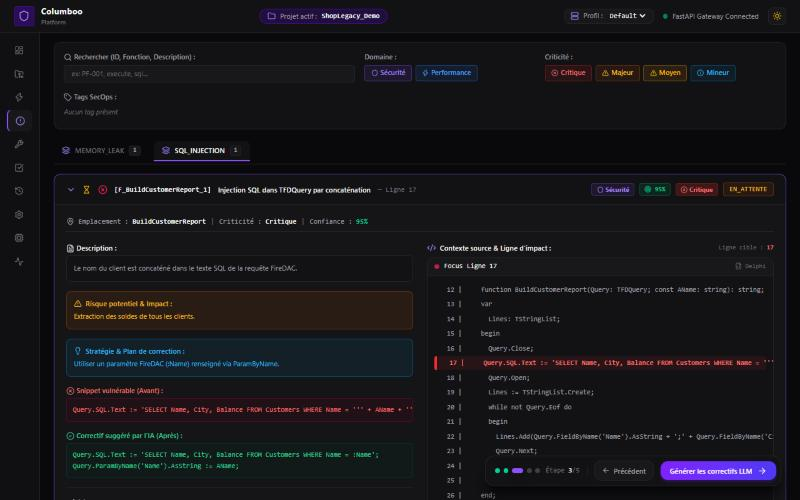

> **Pas de code source dans ce dépôt.** Columboo appartient à BH Technologies. Cette page présente le projet avec l'accord de l'entreprise. Les captures ont été réalisées sur un **projet de démonstration fictif** (une petite boutique en ligne), sans aucun code ni donnée de l'entreprise.

---

## En bref

| | |
| --- | --- |
| **Mon rôle** | Conception, développement et déploiement, en autonomie, avec la direction technique |
| **Durée** | 3 mois et demi (15 juin au 25 septembre 2026) |
| **Code produit** | ~36 700 lignes sur 140 fichiers : backend Python ~22 600 lignes, frontend TypeScript ~14 000 lignes |
| **Qualité** | 259 tests automatisés (pytest), TypeScript strict sans avertissement ni `any` |
| **Résultat clé** | 94 % des correctifs validés en deux passes ou moins, sur 50 remédiations réelles |
| **Stack** | FastAPI, React 18, TypeScript, Ollama, KVM, Server-Sent Events, Pydantic |

---

## Le problème

L'entreprise opère dans le traitement de titres prépayés et de cartes cadeaux, un secteur encadré par la norme **PCI-DSS v4.0**. Une partie de ses applications d'encaissement est écrite en Delphi et en .NET depuis une vingtaine d'années. Ce code contient des pratiques aujourd'hui jugées risquées (requêtes SQL concaténées, gestion manuelle de la mémoire), mais le réécrire est hors de question : trop coûteux, trop risqué.

Les solutions habituelles ne convenaient pas :

- **Les scanners statiques (SAST)** produisent beaucoup de faux positifs, connaissent mal le Pascal objet et ne proposent aucun correctif.
- **Les assistants IA en ligne** obligent à envoyer du code propriétaire à un tiers, ce qui est incompatible avec PCI-DSS et les engagements de confidentialité.

**L'objectif :** un outil souverain qui comprend le code legacy, laisse l'ingénieur arbitrer, corrige de façon chirurgicale, vérifie que le code compile toujours et garde une trace de tout.

---

## Le parcours en 5 étapes

| # | Étape | Ce qui se passe |
| --- | --- | --- |
| 1 | **Ingestion** | Import d'un dépôt (dossier local, ZIP ou GitLab), détection du langage de chaque fichier |
| 2 | **Audit sémantique** | Chaque fonction est analysée par un agent auditeur, avec un flux de résultats en direct |
| 3 | **Triage** | L'ingénieur valide, rejette ou précise chaque alerte, avec le code fautif et la correction suggérée côte à côte |
| 4 | **Usine à patchs** | Une boucle d'agents génère des correctifs ciblés, contrôlés par l'AST et par un agent relecteur |
| 5 | **Validation** | Compilation réelle en machine virtuelle, export certifié et Merge Request GitLab |

---

## Architecture

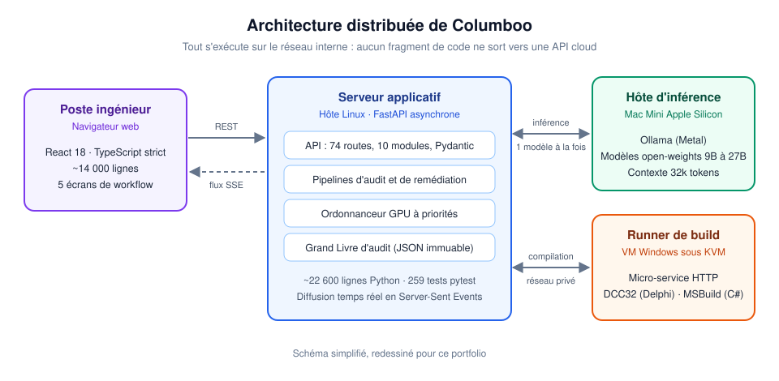

Trois contraintes ont guidé l'architecture :

1. **Confidentialité.** Toute l'inférence tourne sur des modèles open-weights hébergés en interne, via Ollama sur un Mac Mini Apple Silicon. Aucune API cloud n'est appelée.
2. **Compilateur legacy.** Le compilateur Delphi (DCC32) n'existe que sous Windows, alors que le serveur tourne sous Linux. J'ai donc isolé la compilation dans une **VM Windows sous KVM**, plafonnée à 3,5 Go de RAM et reliée au serveur par un réseau privé.
3. **Mémoire limitée.** Chaque modèle de 26 à 27 milliards de paramètres occupe ~16 Go de mémoire unifiée. Si deux modèles tournent en même temps, la machine sature et se fige. Il fallait donc **sérialiser l'accès au GPU**.

---

## La boucle multi-agents

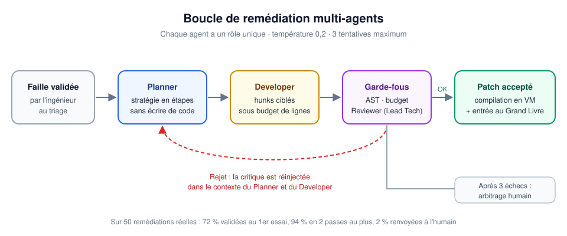

Plutôt qu'un seul prompt généraliste, chaque tâche est confiée à un agent spécialisé :

| Agent | Rôle | Modèle | Sortie |
| --- | --- | --- | --- |
| **Auditor** | Détecter les failles dans chaque fonction | BugTraceAI-Apex (26B) | Constats structurés : CWE, ligne, sévérité, remédiation |
| **Planner** | Définir la stratégie, sans écrire de code | Cyber-agentic (27B) | Plan en étapes (JSON) |
| **Developer** | Traduire le plan en modifications ciblées | Swift-Qwen (27B) | Blocs différentiels `EditHunk` |
| **Reviewer** | Jouer le Lead Tech contradictoire | Ornith-1.0-9B (Q8_0) | Décision, score de confiance, critique |

Quand un correctif est rejeté, par l'AST, par le budget de modification ou par le Reviewer, la critique est réinjectée dans le contexte de la tentative suivante, dans la limite de **trois essais**. Au-delà, la faille revient à l'ingénieur.

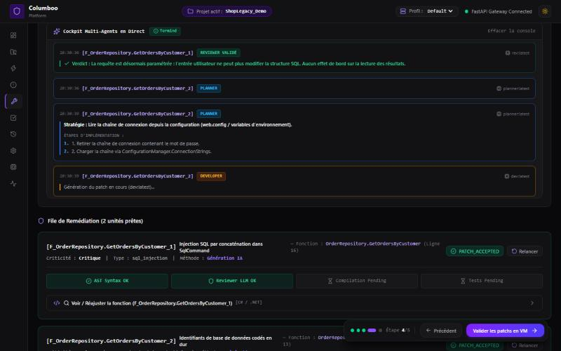

---

## Choix techniques marquants

**Ordonnanceur GPU à priorités.** Un gestionnaire unique (singleton) fait passer toutes les inférences par une seule file :
- les actions interactives de l'ingénieur passent avant les audits massifs ;
- chaque utilisateur est limité à trois tâches en attente ;
- une sonde détecte si une autre application occupe le GPU et met Columboo en pause.

**Découpage sémantique et KV-Cache.** Les fichiers legacy dépassent souvent 1 000 lignes. Ils sont donc découpés en fonctions, enrichies de l'en-tête du fichier (types, variables globales) pour limiter les faux positifs. Les prompts sont séparés en un préfixe système fixe, gardé en cache par Ollama, et une partie variable qui contient le code. Résultat : **environ 35 % de temps de traitement initial en moins** par bloc.

**Correctifs chirurgicaux.** Le Developer ne réécrit jamais un fichier entier. Il produit des blocs `EditHunk` (ligne de début, ligne de fin, nouveau code), appliqués du bas vers le haut. Le reste du fichier reste identique au caractère près.

**Streaming en temps réel.** Les audits longs sont diffusés en Server-Sent Events. La console de l'interface affiche chaque fonction analysée au fil de l'eau, sans requêtes répétées vers le serveur.

**Registre immuable, sans base de données.** Chaque correctif accepté produit un document JSON `PF-XXXXXX` : la faille, la stratégie, le diff, l'opérateur et le verdict du Reviewer. Les écritures sont atomiques (fichier temporaire, puis renommage), donc une coupure de courant ne peut pas corrompre le registre. Chaque entrée est rattachée à **OWASP ASVS 4.0** et **PCI-DSS v4.0**.

---

## Le parcours en images

*Captures réalisées sur le projet de démonstration fictif.*

| Audit en direct | Triage des alertes |
| --- | --- |
| 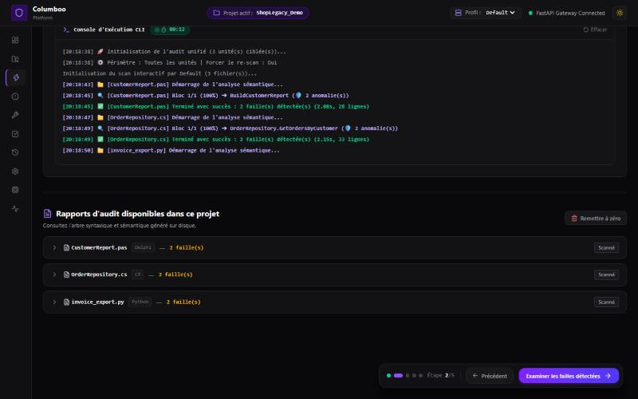 | 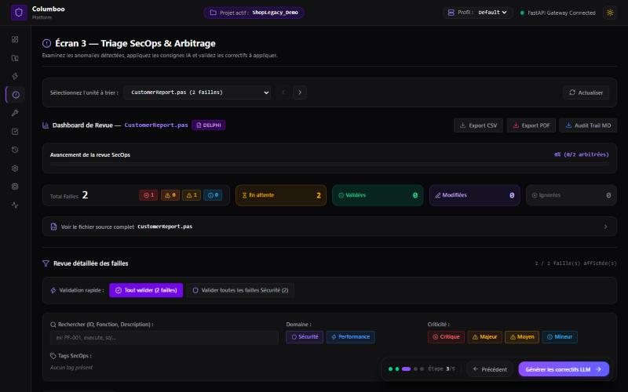 |
| **Chaîne de confiance** | **Code corrigé et tracé** |
| 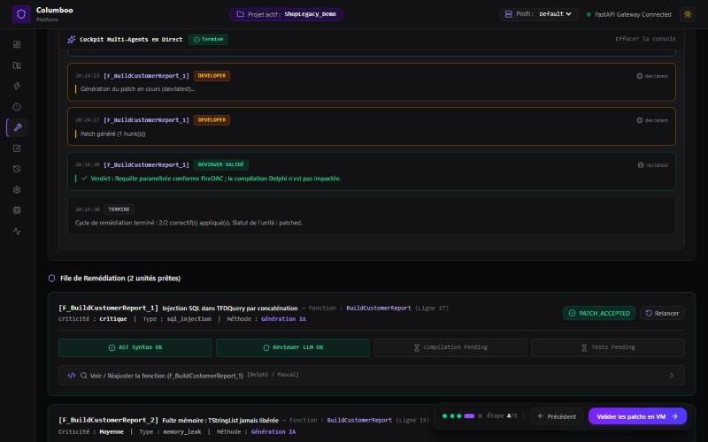 | 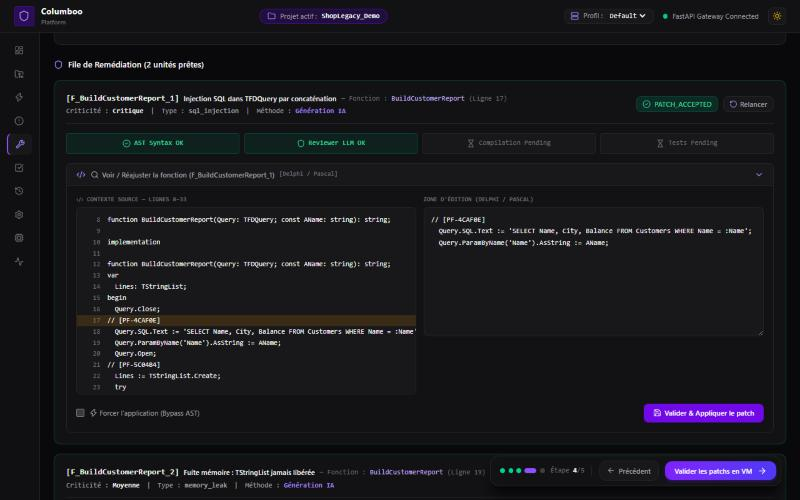 |
| **Validation et build** | **Registre de conformité** |
| 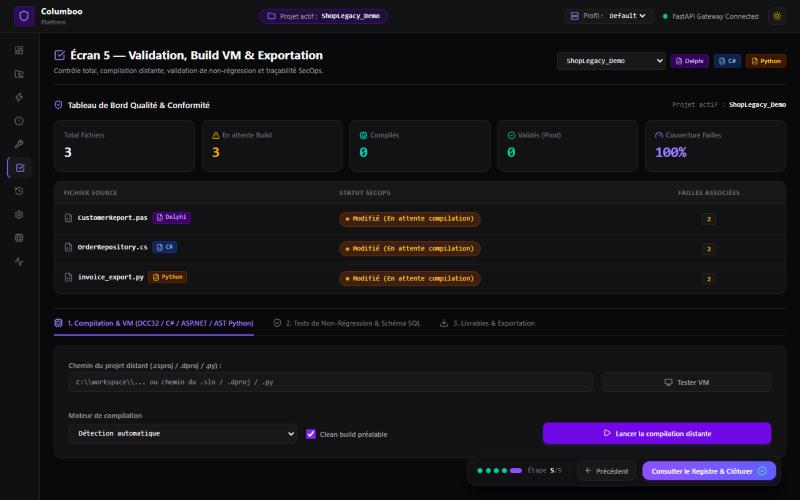 | 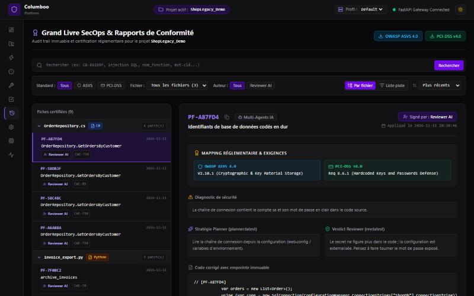 |

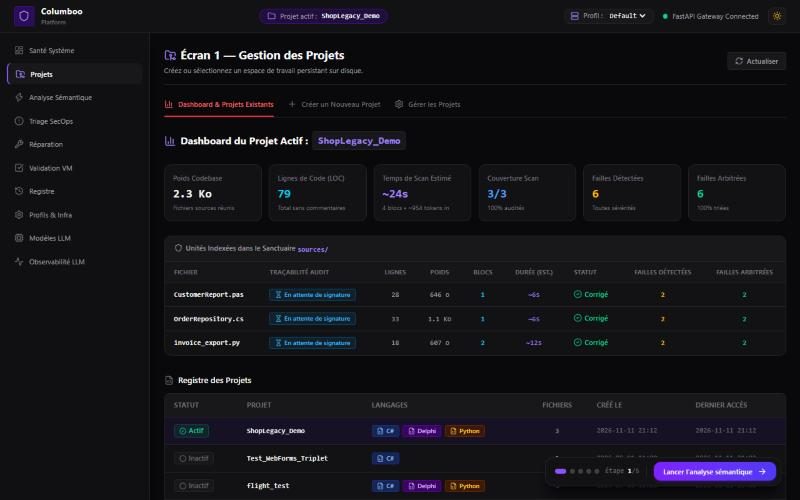

---

## Résultats

Mesures réalisées sur les dépôts réels de l'entreprise.

**Performance de l'audit**

| Mesure | Valeur |
| --- | --- |
| Temps moyen par fonction (200 à 400 lignes, modèle 26B) | 7,46 s |
| Fichier complexe de 11 fonctions | 1 min 22 s |
| Démarrage à froid de toute l'infrastructure | moins de 2 min, sans intervention |

**Convergence de la boucle multi-agents** (50 remédiations)

| Tentative | Part des correctifs |
| --- | --- |
| Validés au 1er essai | 72 % |
| Validés au 2e essai | 22 % |
| Validés au 3e essai | 4 % |
| Renvoyés à l'ingénieur | 2 % |

**Cloud ou local ?** J'ai comparé un GPU cloud (OVH, carte L4) au cluster local :

| Critère | Cloud | Local (Mac Mini) |
| --- | --- | --- |
| Coût | ~0,80 €/h, plus les transferts | matériel amorti, aucun coût à l'usage |
| Confidentialité | données envoyées chez un tiers | données confinées au réseau interne |
| Latence réseau | 80 à 150 ms par appel | moins de 1 ms |
| Consommation | 250 à 350 W en continu | 30 à 50 W en inférence, 3 à 7 W au repos |
| Temps par fonction | ~6,2 s | 7,46 s |

Le local est un peu plus lent, mais il l'emporte sur tous les autres critères.

---

## Difficultés rencontrées

**La machine se figeait 30 à 60 secondes.** Quand deux modèles étaient sollicités en parallèle, Ollama déchargeait l'un pour charger l'autre, en boucle. Je l'ai résolu avec l'ordonnanceur GPU, la file à priorités et la sonde qui détecte les modèles étrangers.

**Le modèle écrivait du Delphi comme du C.** Sur les gros fichiers, il déclarait des variables au milieu du code, ce que le compilateur rejette. J'ai intégré les règles du Pascal objet dans le prompt du Developer et confié le Reviewer à un modèle plus strict sur la syntaxe. Les erreurs sont désormais rattrapées avant même la compilation.

**Le tableau de bord affichait un GPU cloud « allumé » alors qu'il s'éteignait.** Deux causes : une route forçait le statut `RUNNING`, et une variable d'environnement résiduelle passait avant le profil actif. J'ai revu la priorité de configuration et ajouté un cache « stale-while-revalidate » de 4 s : l'extinction réelle s'affiche maintenant en moins de 5 s.

**Changer de projet bloquait l'interface 2 à 3 secondes.** J'ai mis en cache les manifestes côté serveur, parallélisé les requêtes avec `Promise.all` et ajouté des mises à jour optimistes. La latence perçue est passée **sous 200 ms**.

---

## Limites et pistes d'amélioration

En préparant cette démo, j'ai relu le moteur de correctifs avec du recul et trouvé deux défauts :

- **Un correctif d'une seule ligne perdait son indentation.** Sans incidence en Delphi, mais bloquant en Python : l'AST le rejetait. Dans un cas, le code se retrouvait même au mauvais niveau tout en restant syntaxiquement valide. La correction est simple : ne pas retirer l'indentation de la première ligne.
- **Une règle du budget de modification visait le bloc `var` du Delphi**, mais se déclenchait aussi sur le mot-clé `var` du C#. Il faudrait l'appliquer selon le langage.

C'est exactement le rôle des garde-fous : ces deux cas ont été arrêtés ou signalés au lieu de passer en silence. Ils montrent aussi qu'il manquait des tests sur ces cas limites.

Autres pistes, issues de mon rapport :

- compresser les prompts du Planner et du Developer, pour 15 à 20 % de tokens en moins ;
- mettre Ollama en veille et éteindre la VM de compilation après deux heures d'inactivité, pour descendre sous 2 W la nuit ;
- étendre le support du C#.

---

## Ce que j'en retiens

- **Concevoir une boucle multi-agents contradictoire**, avec réinjection des critiques et budget de modification, plutôt qu'un seul prompt.
- **Les contraintes réelles de l'inférence locale** : mémoire unifiée, ordonnancement du GPU, KV-Cache.
- **Arbitrer entre l'idéal et le faisable** : par exemple, des écritures atomiques sur fichier plutôt qu'une base de données relationnelle.
- **Diagnostiquer par isolation des couches** quand un système distribué sur trois machines et trois OS tombe en panne.

---

## À propos de cette démo

Les captures ont été réalisées sur un projet fictif de trois fichiers (C#, Python et Delphi), contenant six failles volontaires : injections SQL, mot de passe codé en dur, désérialisation `pickle`, injection de commande et fuite mémoire. Le serveur d'inférence était remplacé par un simulateur, faute de GPU suffisant sur ma machine. Tout le reste est l'application réelle : le pipeline, les garde-fous, l'interface et le registre.

---

**Mattéo Bombrun** · Élève-ingénieur en IA, ESME Paris · [LinkedIn](https://www.linkedin.com/in/matt%C3%A9o-bombrun-b67993257/) · [GitHub](https://github.com/Monday69)
